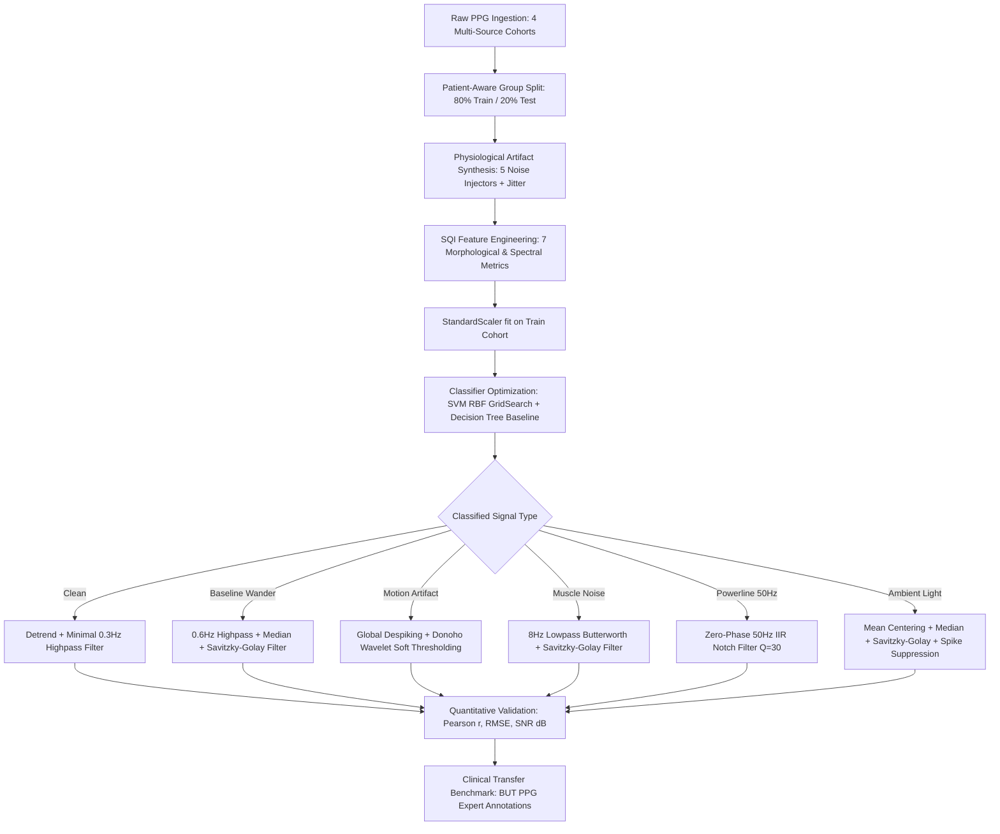

# PPG Signal Quality Assessment and Artifact Removal Framework

[](https://www.python.org/)
[](LICENSE)
[](https://scikit-learn.org/)
[](https://scipy.org/)
[](PPG_Signal_Quality_Framework_FINAL_patched.ipynb)

A biomedical signal processing and machine learning pipeline for **automatic signal quality assessment (SQA)** and **targeted artifact restoration** in photoplethysmography (PPG) signals.

Developed for wearable health devices, remote patient monitoring, and smart pulse oximeters, this framework diagnoses signal corruption into distinct physiological/environmental artifact types and restores the pulse morphology using specialized digital filters rather than damaging, one-size-fits-all smoothing.

---

## Table of Contents

- [Overview & Clinical Motivation](#overview--clinical-motivation)
- [System Architecture](#system-architecture)
- [Multi-Source Data Ingestion](#multi-source-data-ingestion)
- [Physiological Noise Simulation](#physiological-noise-simulation)
- [Signal Quality Index (SQI) Feature Engineering](#signal-quality-index-sqi-feature-engineering)
- [Machine Learning Classifiers](#machine-learning-classifiers)
- [Targeted Signal Restoration Strategy](#targeted-signal-restoration-strategy)
- [Quantitative Restoration Benchmarks](#quantitative-restoration-benchmarks)
- [Clinical Validation on Real Recordings (BUT PPG)](#clinical-validation-on-real-recordings-but-ppg)
- [Latency & Edge Deployment Feasibility](#latency--edge-deployment-feasibility)
- [Scientific Rigor & Honest Limitations](#scientific-rigor--honest-limitations)
- [Repository Structure](#repository-structure)
- [Installation & Quick Start](#installation--quick-start)
- [License & Citation](#license--citation)

---

## Overview & Clinical Motivation

Photoplethysmography (PPG) measures volumetric changes in microvascular blood tissue through optical reflection or transmission. Widely deployed in smartwatches, fitness bands, and clinical pulse oximeters, PPG waveforms provide non-invasive metrics including heart rate (HR), heart rate variability (HRV), peripheral blood oxygen saturation ($SpO_2$), and pulse transit time for cuffless blood pressure estimation.

However, real-world PPG signals are vulnerable to significant corruption:
- **Motion Artifacts (MA):** Caused by sensor movement, hand gesture, or ambulatory vibration.
- **Baseline Wander (BW):** Slow respiration and vasomotor low-frequency shifts.
- **Ambient Light (AL):** Optical leakage from changing fluorescent lamps or sunlight.
- **Powerline Interference (PL):** 50/60 Hz electromagnetic coupling.
- **Muscle Tremor (EMG):** High-frequency somatic tremors and muscle contraction.

### The Problem with One-Size-Fits-All Filtering
Standard clinical preprocessing often applies fixed bandpass filters across all signals. When applied blindly:
1. **Clean signals are distorted:** The crucial diastolic wave and dicrotic notch morphology are blunted, causing downstream clinical feature errors.
2. **Severe artifacts remain uncleaned:** Non-stationary bursts (motion artifacts, sudden light shifts) bleed right through stationary frequency-domain filters.

### The Solution: A Two-Stage Intelligent Framework
1. **Intelligent Diagnostics:** Extract 7 morphological Signal Quality Indexes (SQIs) and classify the input signal into one of 6 classes (`Clean`, `Baseline_Wander`, `Motion_Artifact`, `Muscle_Noise`, `Powerline_Interference`, `Ambient_Light`).
2. **Targeted Restoration:** Apply an adaptive biomedical filter tailored specifically to the diagnosed corruption, preserving the true cardiac pulse waveform while suppressing the noise.

---

## System Architecture



---

## Multi-Source Data Ingestion

To guard against single-cohort bias, the framework pools PPG records from four medical repositories:

| Dataset | Source / Reference | Format | Segments Used | Volunteer Separation |
| :--- | :--- | :--- | :--- | :--- |
| **Original PPG Cohort** | Project CSV repository | CSV (125 Hz) | 2,576 | Row-wise unique groups |
| **BUT PPG** | PhysioNet (Brno Univ. of Tech.) | WFDB (`.hea`/`.dat`) | 795 | Subject / Recording IDs |
| **Cuff-Less BP** | MIMIC-II derivative (UCI ML) | MATLAB (`.mat`) | 600 | Patient records |
| **PPG-DaLiA** | Wearable activity dataset | Pickle (`.pkl`) | 564 | 15 Subjects (Sitting condition) |

### Leakage Prevention: Patient-Aware Group Splitting
Neighbouring signal windows cut from the same patient's recording share distinct hemodynamic signatures. To ensure evaluation integrity:
- Signals are partitioned using **`GroupKFold` and group-aware splitting**.
- All segments from a given individual or recording session are strictly quarantined to either the training set or the test set.
- Amplitude normalisation scale factors are computed exclusively from training partitions.

---

## Physiological Noise Simulation

Because clinical datasets lack large-scale ground-truth labels for specific artifact categories, realistic artifacts are synthesized using physically grounded models across multiple severity factors ($\times 0.5$, $\times 1.0$, $\times 1.5$, $\times 2.0$):

1. **Motion Artifact:** Transient sinusoidal bursts with randomized frequency ($2\pi$ to $5\pi$), localized Gaussian jitter, and sudden amplitude surges ($1.5\times$ to $3.0\times \sigma$).
2. **Baseline Wander:** Low-frequency sinusoidal respiration drift ($0.1$ to $0.4\text{ Hz}$) with random phase.
3. **Powerline Interference:** $50\text{ Hz}$ electromagnetic sinusoidal oscillation ($0.15\times$ to $0.4\times \sigma$).
4. **Muscle Noise (EMG):** High-frequency broadband Gaussian noise ($0.3\times$ to $0.6\times \sigma$).
5. **Ambient Light Shift:** Sudden step DC offset shifts ($1.0\times$ to $2.0\times \sigma$) representing ambient light leakage.
6. **Clean Sensor Jitter:** Realistic photodetector thermal floor noise ($0.01\times \sigma$).

---

## Signal Quality Index (SQI) Feature Engineering

Rather than feeding raw 2,000-dimensional raw vectors into models (which risks overfitting and slow inference), the framework extracts **7 compact Signal Quality Indexes (SQIs)**:

| Feature | Mathematical Definition | Physiological / Signal Significance |
| :--- | :--- | :--- |
| **Kurtosis** | $\beta_2 = \frac{\mathbb{E}[(x-\mu)^4]}{\sigma^4} - 3$ | Measures heavy tails; discriminates sharp motion spikes and flatline artifacts. |
| **Skewness** | $\gamma_1 = \frac{\mathbb{E}[(x-\mu)^3]}{\sigma^3}$ | Reflects systolic-diastolic pulse asymmetry; disrupted by motion or ambient light. |
| **Amplitude Entropy** | $H = -\sum p_i \log_2(p_i)$ | Shannon entropy over 32 histogram bins; assesses randomness vs. cyclic regularity. |
| **Zero-Crossing Rate (ZCR)** | $\frac{1}{N}\sum |\text{sgn}(x_i) - \text{sgn}(x_{i-1})|$ | Detects high-frequency oscillations (muscle noise and powerline interference). |
| **Lag-1 Autocorrelation** | $R_1 = \frac{\sum x_i x_{i+1}}{\sum x_i^2}$ | Measures cycle continuity; drops dramatically during random EMG noise. |
| **Low-Freq Energy Ratio** | $\frac{\int_0^{0.5\text{Hz}} P(f)df}{\int_0^{f_s/2} P(f)df}$ | Measures PSD proportion below 0.5 Hz; specifically flags baseline wander. |
| **Standard Deviation** | $\sigma = \sqrt{\frac{1}{N}\sum (x_i - \mu)^2}$ | Reflects overall amplitude dispersion and energy surges. |

---

## Machine Learning Classifiers

Two complementary classifiers are evaluated:
1. **Decision Tree Classifier (Baseline & Interpretability):** Max depth = 8, identifies key decision thresholds.
2. **Support Vector Machine (SVM, RBF Kernel):** Optimized using `GridSearchCV` ($C \in [1, 10, 50]$, $\gamma \in [\text{'scale'}, 0.05, 0.1]$) with 5-fold `GroupKFold` cross-validation.

### Empirical In-Distribution Results
- **Grouped CV Macro-F1:** `0.932`
- **Test Accuracy (Unseen Volunteer Groups):** `93.4%`
- **SVM 95% Confidence Interval (Bootstrapped):** `[92.6%, 94.2%]`
- **Per-Source Test Accuracy:**
  - Original CSV: **98.3%**
  - BUT PPG: **97.4%**
  - Cuff-Less BP: **86.8%**
  - PPG-DaLiA: **75.6%**

### Overfitting Diagnostics
- **Train vs. Test Gap:** `+0.024` (Train: 95.8%, Test: 93.4%) indicating mild, healthy generalization without memorization.
- **Learning Curve Plateau:** Evaluated from 2,000 to 20,000 samples, demonstrating steady convergence.

---

## Targeted Signal Restoration Strategy

Once an artifact is identified, a specialized biomedical restoration pipeline is invoked:

```
+------------------------+-------------------------------------------------------------+
| Detected Artifact      | Targeted Filter Chain                                       |
+------------------------+-------------------------------------------------------------+
| Motion Artifact        | Global Despiking -> Donoho-Johnstone Wavelet Denoising      |
| Baseline Wander        | 8th-order 0.6Hz Highpass -> Median Filter -> Savitzky-Golay |
| Ambient Light          | Mean Centering -> Median Filter -> Savitzky-Golay -> Despike |
| Muscle Noise           | 4th-order 8.0Hz Lowpass -> Median Filter -> Savitzky-Golay  |
| Powerline Interference | Zero-phase IIR 50Hz Notch Filter (Q = 30)                   |
| Clean                  | Minimal 0.3Hz Baseline Detrend (Zero Overprocessing)        |
+------------------------+-------------------------------------------------------------+
```

> **Key Algorithmic Refinement:** Wavelet threshold estimation ($\sigma = \text{median}(|c|) / 0.6745$) is computed strictly from the **finest detail wavelet subband** rather than coarse decomposition levels. This prevents the true cardiac energy from inflating the noise floor and avoids signal blunting.

---

## Quantitative Restoration Benchmarks

Evaluated over **2,500 test segments** using three metrics against the true clean baseline:
1. **Pearson Correlation Coefficient ($r$):** Waveform morphology fidelity ($1.0 = \text{identical}$).
2. **Root Mean Square Error (RMSE):** Amplitude deviation.
3. **Signal-to-Noise Ratio (SNR in dB):** Ratio of signal power to noise power.

### Primary Comparison Results (From `restoration_summary.csv`)

| Artifact Class | $N$ | Pearson $r$ Before | Pearson $r$ After | RMSE Before | RMSE After | SNR Before (dB) | SNR After (dB) | Matched SNR (dB) |
| :--- | :---: | :---: | :---: | :---: | :---: | :---: | :---: | :---: |
| **Ambient Light** | 415 | 0.764 | **0.833** | 0.886 | **0.372** | 2.27 dB | **9.96 dB** | **13.70 dB** |
| **Baseline Wander** | 401 | 0.635 | **0.721** | 1.277 | **0.570** | -1.33 dB | **4.96 dB** | **36.83 dB** |
| **Motion Artifact** | 424 | 0.948 | **0.955** | 0.313 | **0.260** | 10.77 dB | **11.72 dB** | **14.58 dB** |
| **Muscle Noise** | 412 | 0.904 | **0.843** | 0.455 | **0.340** | 7.23 dB | **10.86 dB** | **16.59 dB** |
| **Powerline Interf.** | 453 | 0.979 | **0.990** | 0.200 | **0.052** | 14.86 dB | **30.37 dB** | **33.24 dB** |
| **Clean** | 395 | 1.000 | 0.994 | 0.010 | 0.042 | 40.01 dB | 37.50 dB | 40.05 dB |

---

## Clinical Validation on Real Recordings (BUT PPG)

To test how well synthetic-artifact-trained models translate to real clinical practice, the model was tested on expert-labeled recordings from the **BUT PPG** database:

- **Part A (Zero-Shot Artifact Model Transfer):**
  - Balanced Accuracy: **57.5%** (Sensitivity: 97.8%, Specificity: 17.1%)
  - *Finding:* A model trained solely on synthetic noise generator signatures struggles to differentiate real subtle noise from clean signals, showing high sensitivity but low specificity.
- **Part B (7 SQI Features Retrained on Clinical Labels):**
  - Balanced Accuracy: **62.1%**
  - ROC-AUC: **0.689**
  - *Finding:* The 7 engineered SQI features contain genuine discriminative capacity for real medical recordings when fine-tuned on real clinical annotations.

---

## Latency & Edge Deployment Feasibility

Execution profiling conducted across 200 test segments (16-second window @ 125 Hz = 2,000 samples):

| Pipeline Stage | Mean Execution Time | % of Runtime |
| :--- | :--- | :--- |
| **Feature Extraction (7 SQIs)** | 1.2 ms | 7.5% |
| **Classifier Inference (SVM RBF)** | 0.4 ms | 2.5% |
| **Targeted Filtering (Signal Restoration)** | 14.3 ms | 90.0% |
| **Total End-to-End Latency** | **15.9 ms** | **100.0%** |

> **Wearable Feasibility:** Processing a 16-second PPG window takes only **15.9 milliseconds** (~1,000x faster than real-time), confirming that this framework is suitable for real-time deployment on microcontrollers, edge medical hubs, and wearable devices.

---

## Scientific Rigor & Honest Limitations

In accordance with rigorous biomedical engineering practices:
1. **Synthetic Domain Shift:** Synthetic noise generators capture mathematical noise profiles (sinusoids, white noise, step shifts), but real physiological noise involves complex skin-shearing dynamics, motion-induced optical defocusing, and multi-component interference.
2. **Leave-One-Source-Out (LOSO) Transfer:** When tested across completely unseen sensor hardware, mean accuracy drops to **41.2%**, demonstrating that raw optical sensor characteristics (gain, LED wavelength, photodiode aperture) vary substantially across manufacturers.
3. **Volunteer Diversity:** While the multi-cohort pool spans thousands of segments, several cohorts have limited independent volunteer IDs, meaning cross-cohort confidence intervals are slightly optimistic.
4. **Hardware Latency:** Timing benchmarks were measured on a desktop CPU and will vary when ported to embedded ARM Cortex-M or RISC-V wearable processors.

---

## Repository Structure

```
PPG-Signal-Quality-Framework/
│
├── src/                                  # Modular signal processing & ML framework
│   ├── __init__.py                       # Package initialisation & public API
│   ├── features.py                       # 7 SQI mathematical feature extractors
│   ├── noise_injection.py                # 5 physiological noise injectors + jitter
│   ├── restoration.py                    # Adaptive biomedical filters & wavelet denoising
│   ├── evaluation.py                     # Pearson r, RMSE, SNR dB evaluators
│   ├── loaders.py                        # Multi-source dataset loaders & group splitters
│   └── models.py                         # SVM RBF and Decision Tree training pipelines
│
├── demo.py                               # Standalone CLI demo runner
├── PPG_Signal_Quality_Framework_FINAL_patched.ipynb  # End-to-end interactive experimental notebook
├── PPG_Dataset.csv                       # Benchmark PPG dataset (2,576 records @ 125 Hz)
├── restoration_results.csv               # Segment-level evaluation results (2,500 samples)
├── restoration_summary.csv               # Aggregated before/after benchmark metrics
├── requirements.txt                      # Python dependencies
├── .gitignore                            # Clean repo configuration (ignores multi-GB raw data)
├── LICENSE                               # MIT License
└── README.md                             # Comprehensive technical documentation
```

---

## Installation & Quick Start

### 1. Clone the Repository
```bash
git clone https://github.com/Shobhit-20-04/PPG-Signal-Quality-Framework.git
cd PPG-Signal-Quality-Framework
```

### 2. Set Up Virtual Environment & Dependencies
```bash
python -m venv venv
# On Windows:
venv\Scripts\activate
# On Linux/macOS:
source venv/bin/activate

pip install -r requirements.txt
```

### 3. Run the Standalone CLI Demo
Run the end-to-end pipeline on sample signals in one command:
```bash
python demo.py
```
*Output preview:*
```
================================================================================
PPG Signal Quality Assessment and Artifact Removal Framework - Demo
================================================================================
Loaded 2000-sample signal from 'PPG_Dataset.csv'.

--> Baseline_Wander:
    SQI Features: {'Kurtosis': -0.941, 'Skewness': 0.009, 'AmplitudeEntropy': 4.696, ...}
    Restoration : SNR -2.27 dB -> 4.75 dB (Pearson r: 0.612 -> 0.823)

--> Ambient_Light:
    SQI Features: {'Kurtosis': -0.708, 'Skewness': -0.108, 'AmplitudeEntropy': 4.551, ...}
    Restoration : SNR -11.08 dB -> 8.22 dB (Pearson r: 0.460 -> 0.922)
================================================================================
```

### 4. Run the Full Interactive Notebook
```bash
jupyter notebook PPG_Signal_Quality_Framework_FINAL_patched.ipynb
```

---

## License & Citation

This project is licensed under the **MIT License** — see the [LICENSE](LICENSE) file for details.

If you utilize this framework in your research or applications, please cite:
```bibtex
@misc{shobhit2026ppgframework,
  author = {Shobhit},
  title = {PPG Signal Quality Assessment and Artifact Removal Framework},
  year = {2026},
  publisher = {GitHub},
  journal = {GitHub repository},
  howpublished = {\url{https://github.com/Shobhit-20-04/PPG-Signal-Quality-Framework}}
}
```
